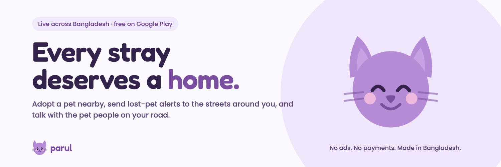
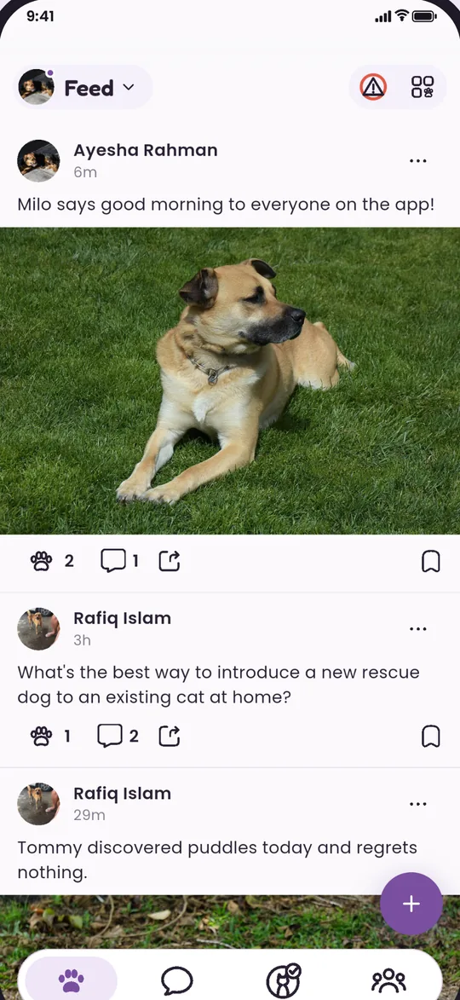
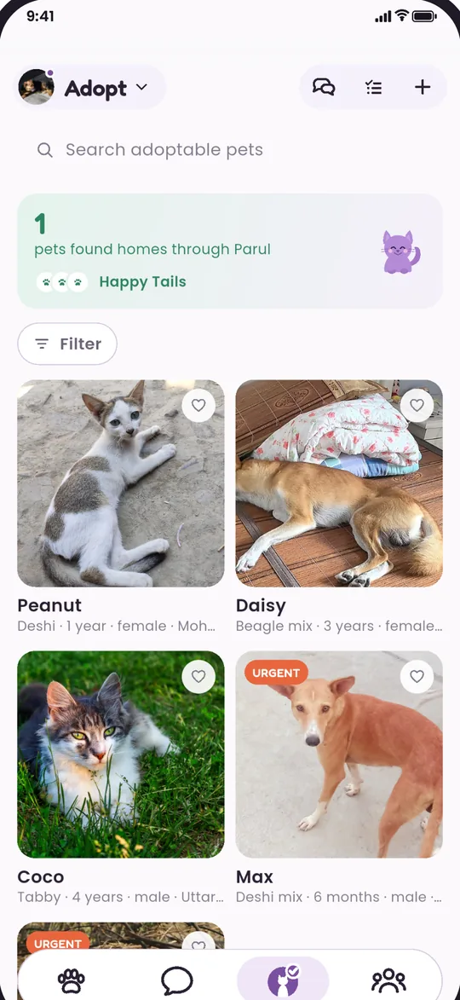
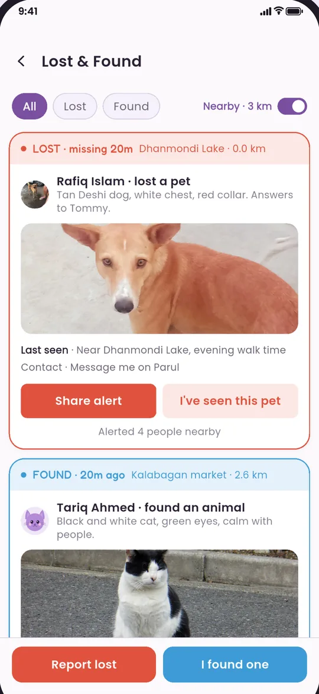
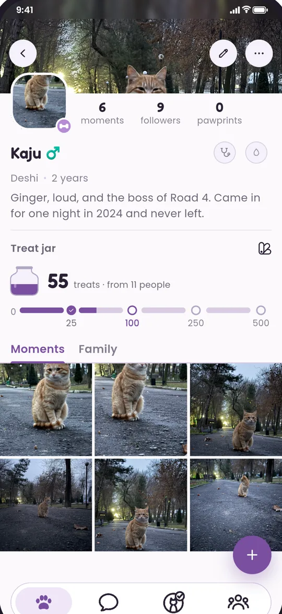
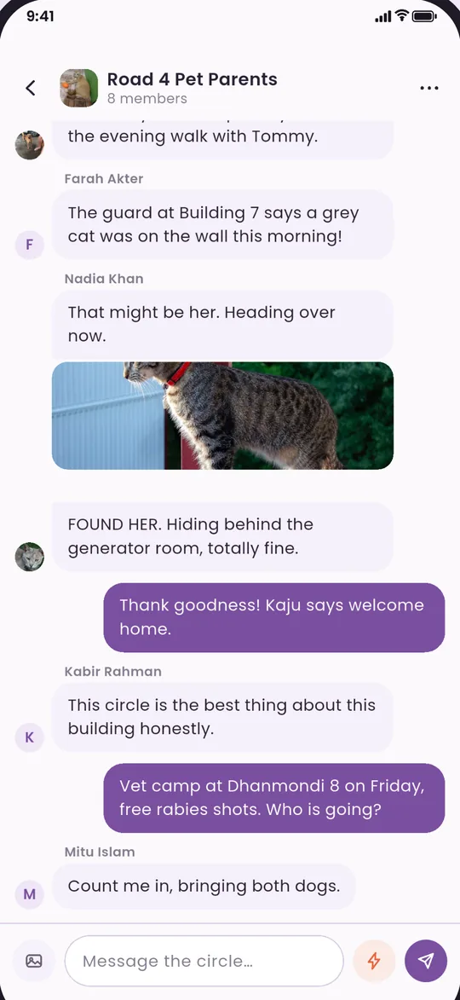
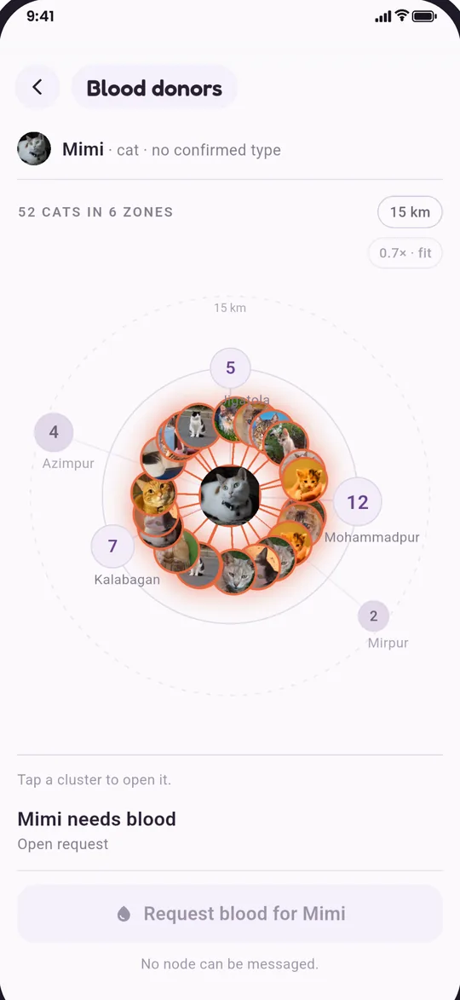
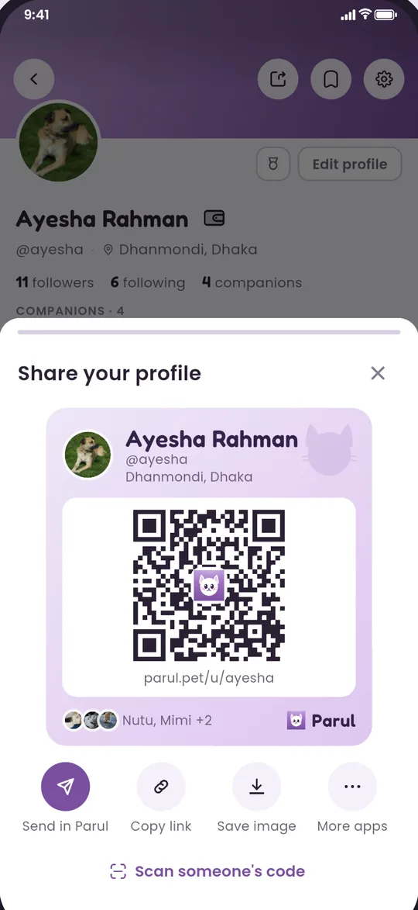
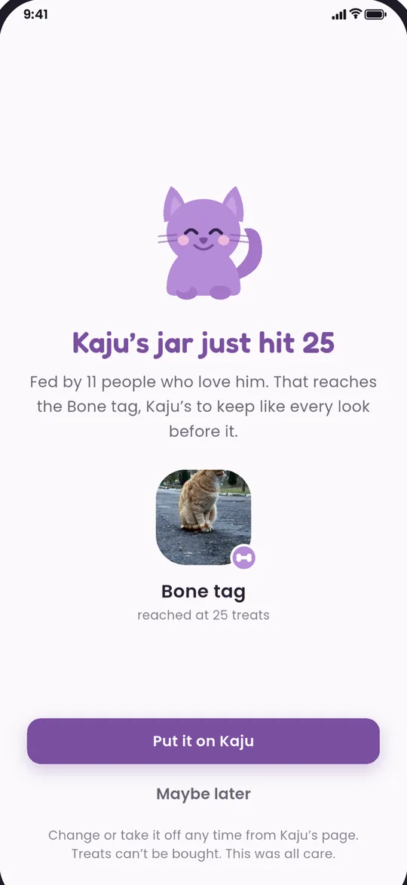

<picture>
  <source media="(prefers-color-scheme: dark)" srcset="https://raw.githubusercontent.com/Parul-Pet/.github/main/profile/banner-dark.png">
  
</picture>

# Parul

**Every stray deserves a home.** Parul brings a neighbourhood together for its animals. Adopt a pet nearby, send a lost-pet alert to the streets around you, and talk with the people on your road who love animals too.

Live across Bangladesh, free on Google Play. No ads, no payments, made in Bangladesh.

## Four ways to help, from your own street

| | |
|---|---|
| 🏠 **Adopt** | Browse pets looking for a home close to yours, then message the person caring for them. |
| 📍 **Lost & Found** | Report a lost or found pet, and the alert reaches the people on the streets nearby. |
| 🏘️ **Circles & Communities** | Private circles for your building and your road, and open communities for every kind of pet person. |
| 🩸 **Blood donors** | Register your dog or cat once. When a pet nearby needs blood, the right donors hear about it. |

## A closer look

<table>
  <tr>
    <td align="center"> <b>Feed</b></td>
    <td align="center"> <b>Adopt</b></td>
    <td align="center"> <b>Lost & Found</b></td>
    <td align="center"> <b>Pet pages</b></td>
  </tr>
  <tr>
    <td align="center"> <b>Circles</b></td>
    <td align="center"> <b>Blood donors</b></td>
    <td align="center"> <b>Share</b></td>
    <td align="center"> <b>Treat jar</b></td>
  </tr>
</table>

## Free, for good

Every pet on Parul has a treat jar. Neighbours fill it by cheering on the pet, and each milestone earns a new tag. **Treats are earned with care, never bought.** There are no ads, no payments and no paid boosts anywhere in the app.

## Coming soon

**Rescue** · **Foster** · **Transport** · **Vet care** · **Shop**

More ways to help are on the way, from reporting an animal in trouble to lending a ride to the vet.

## Get in touch

- **Website**: [parul.pet](https://parul.pet)
- **Support**: [support@parul.pet](mailto:support@parul.pet)
- **Safety reports**: [safety@parul.pet](mailto:safety@parul.pet)
- **Security**: [security@parul.pet](mailto:security@parul.pet)

Parul is built by <a href="https://github.com/SocioFi-Technology">SocioFi Technology</a> in Dhaka, Bangladesh · <a href="https://parul.pet/privacy">Privacy</a> · <a href="https://parul.pet/terms">Terms</a> · <a href="https://parul.pet/guidelines">Community Guidelines</a> · <a href="https://parul.pet/child-safety">Child Safety</a>
